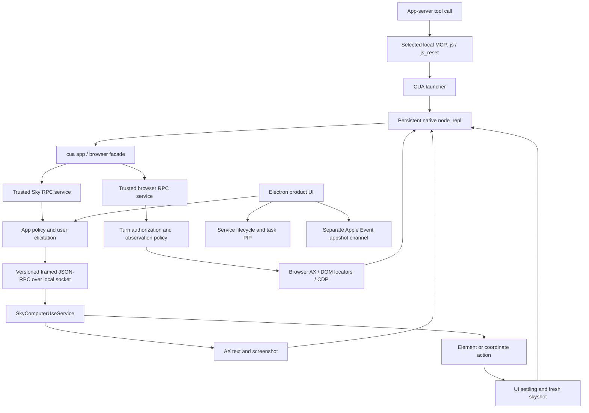

# ChatGPT Computer Use: static investigation for Jarvis

2026-10-12 · Installed target: `/Applications/ChatGPT.app` · Initial static report: `jarvis-qqqi` (closed) · Remaining investigation: `jarvis-mc9s` (open)

The installed application implements Computer Use as a **persistent JavaScript tool facade connected to separate native-app and browser services**. Native perception combines accessibility text with screenshots; input targets an approved application and can use element identities or coordinates. The shipped client has explicit versioning, deadlines, serialized requests, structured errors, app approvals and browser policy boundaries. It is considerably more than a screenshot/click pair.

This is the initial static investigation, with broad package coverage and focused executable control-flow analysis. It is **not a completed runtime/security audit or proof of full product parity**. Complete native enforcement, evaluator isolation, physical coordinate calibration, locked use and server behavior remain open. No Jarvis source implementation, target-service execution, user-state inspection, commit, push or remote sync was performed.

## Reading order and retained evidence

| Artifact | What it establishes |
| --- | --- |
| [javascript-flow.md](/Users/enesolucoes/Documents/Pessoal/jarvis/docs/research/chatgpt-computer-use-2026-10-12/javascript-flow.md) | Installed Electron activation, catalog configuration, trusted host services, service lifecycle, approval UI, Apple Event appshots, PIP and locked-use settings. Ten ASAR members have source hashes, original carrier offsets and function positions. |
| [cua-protocol.md](/Users/enesolucoes/Documents/Pessoal/jarvis/docs/research/chatgpt-computer-use-2026-10-12/cua-protocol.md) | Persistent API, app/tab binding, AX/screenshot/DOM perception, action schemas, native IPC, app grants, signed browser gate, credential protection and bounded telemetry findings. Thirty-three installed source files were checked against REA inventory hashes. |
| [native-static.md](/Users/enesolucoes/Documents/Pessoal/jarvis/docs/research/chatgpt-computer-use-2026-10-12/native-static.md) | Native binary identities, direct action/capture call edges, recovered PIP bootstrap pseudocode, imports, helper declarations, signature evidence and provider limitations. |
| [jarvis-reference-map.md](/Users/enesolucoes/Documents/Pessoal/jarvis/docs/research/chatgpt-computer-use-2026-10-12/jarvis-reference-map.md) | Current Jarvis integration sites and the mandatory Codex → OpenCode → OMP comparison, with source/test anchors and explicit search boundaries. Reference trees were read only. |
| [evidence-manifest.json](/Users/enesolucoes/Documents/Pessoal/jarvis/docs/research/chatgpt-computer-use-2026-10-12/evidence-manifest.json) | Compact identities, REA Evidence IDs, seven integrity contradictions, residual unknowns and local evidence-bundle hashes. |
| [native-call-evidence.json](/Users/enesolucoes/Documents/Pessoal/jarvis/docs/research/chatgpt-computer-use-2026-10-12/native-call-evidence.json) | Reproducible LLVM command, static address spans, assembly hashes and exact direct-call mapping. Supplemental observations are labeled N01–N09. |
| [rea-evidence.json](/Users/enesolucoes/Documents/Pessoal/jarvis/docs/research/chatgpt-computer-use-2026-10-12/rea-evidence.json) | Full local REA ledger: 26 records and seven residual unknowns, 86,301,546 bytes. Retained locally and ignored by Git. |
| [rea-analysis.snapshot.json](/Users/enesolucoes/Documents/Pessoal/jarvis/docs/research/chatgpt-computer-use-2026-10-12/rea-analysis.snapshot.json) | Provider-neutral REA snapshot. It is not a verified Hopper database or a complete native decompilation. Retained locally and ignored by Git. |

The main application reports version `26.1007.30912`, build `20156`. Its package is `openai-codex-electron`, product `Codex`, even though the supplied installed directory is named ChatGPT. Findings belong to these installed bytes, rather than every ChatGPT release or platform. The Computer Use service is independently versioned `26.1005.1001425` and declares minimum macOS 14.4.

## Evidence vocabulary

The follow-up [cursor and live preview investigation](./cursor-preview.md) records the same-process Jarvis crash, six additional REA records, native feedback implementation choices, and the remaining visual-parity limits.

- **Confirmed static:** the indicated shipped control flow, declaration, native call or decompiler relationship was observed. A declared entitlement, instruction or import is explicitly identified as such.
- **Documented contract:** bundled agent-facing instructions describe required behavior; executable enforcement has not automatically been established.
- **Inference:** an architectural interpretation or recommendation follows from cited observations but is not directly recovered as a complete implementation.
- **Unknown:** the available authority cannot answer the question; the report records the next probe needed.

File names and strings located candidates. The stronger conclusions use source control flow, parsed schemas, exact addresses and independent identities. Negative findings stay bounded to their searched directories/functions. No claim of successful action or permission is based on file presence.

## Reconstructed static flow

Solid arrows represent inspected routing relationships. The external model/server behavior and inner native REPL evaluator were not recovered.

Three boundaries must remain distinguishable:

1. **App automation:** `@oai/sky` talks to a separate signed macOS service. The exposed macOS JS API is app-scoped; a full Linux desktop interface elsewhere in the package does not prove the same macOS contract.
2. **Browser automation:** `@oai/browser-desktop` provides backend-specific browser operations and Playwright-style locators through trusted RPC. AX support is conditional. It also has browser-specific authorization, URL and credential restrictions.
3. **Appshots/context capture:** Electron worker code uses Apple Events for asynchronous app capture and permission handling. This is a separate product capture path; the investigation does not assume every CUA screenshot goes through it.

PIP/virtual cursor is presentation and coordination infrastructure. Locked-computer support has separate installer, authorization plug-in and guardian components. Neither proves that ordinary actions require or use those components.

## Findings that matter for reconstruction

| Finding | Confidence and evidence | Practical implication |
| --- | --- | --- |
| Availability combines feature/account requirements, selected installed plugins, platform, executable paths and app-server tool-exposure support. Defaults alone do not establish current activation. | Confirmed static: `ks`, `ire`, `rne`, `hc`; JS-CU-01/02. | Represent unavailable, permission-pending and ready capabilities explicitly. |
| The public facade is persistent `cua`; app/tab selection returns the first UI state and documentation. JS bindings reset independently of UI state. Documentation is emitted selectively and can be replayed after compaction. | Confirmed facade/emitter; reset and first-use sequencing are documented contracts: P02–P07, P20–P22, P31/P32. | Maintain target identity and concise capability documentation across the agent loop. A persistent arbitrary-code REPL is a design option, not a requirement for Jarvis's first implementation. |
| Observation can return native AX text, screenshot bytes, both, browser AX, or DOM snapshots. A failing inventory surface does not discard the others. | Confirmed static: P06/P07/P13/P14/P16/P17 and browser service. | Use semantic observations where available, retain images and preserve partial successful results. |
| macOS native input supports indexed-element or coordinate click, drag, paste, typing, key press/hold, scroll, value setting, text selection and secondary actions. | Confirmed adapter schema: P10 and method files. N03/N04 corroborate native click processing. | Separate observed target binding, action validation, dispatch receipt and effect verification. |
| App reads/actions obtain policy, then request app-specific user approval. Approved execution is rebound to canonical app path; accessor-based input objects are rejected/frozen. | Confirmed static wrapper: P12, plus UI JS-CU-05. Native complete enforcement remains open. | App identity and scope belong in host-owned authorization state; a name string alone is insufficient. |
| Local native transport has API `CodexComputerUseIPC-5`, a version ping, IDs, deadlines, a serial queue and bounded frames. Timeout retires pending state; late replies are ignored. Actions are not automatically resent. | Confirmed static: P10/P11; REA AST/view evidence below. | Version contracts and preserve uncertain action outcomes after cancellation or lost replies. |
| Native click regions call target/window selection, coordinate transforms, event posting, UI settling and fresh skyshot capture. | Confirmed direct static calls: N01–N05. Complete async/native graph remains partial. | Pixel geometry, target freshness and post-action observation are essential, beyond implementing a click function. |
| Electron's trusted host-services pipe is internal, mode 0600, and includes peer-authorization support. PIP endpoint bootstrap checks an XPC audit-token PID. | Confirmed inspected call paths: JS-CU-03/04 and `sky.node` procedure at `0x12428`. | Local IPC still needs caller identity checks. A socket path or same-user assumption is not a complete trust boundary. |
| Browser access can require a signed per-turn response bound to executor/session/turn/nonce. The inspected gate is conditional when the executor-ID environment is absent. Credential/URL observation checks surround relevant browser operations; raw CDP has additional restrictions. | Confirmed specific code paths: P24; complete bypass analysis open. | Browser admission and observation restrictions need explicit enforcement around powerful escape hatches. |
| Action-sensitive confirmations include agent-facing policy prose. App grants and action confirmations are distinct. | Documented contract: P19 and injected confirmation policy. App grant wrapper is executable. | Do not claim that an app allowlist prevents every dangerous UI action or that every sensitive click receives semantic enforcement. |
| Sky telemetry sends identifiers, app/action duration/status and approval metadata; this inspected module does not include screenshot/AX-text payloads. | Confirmed bounded module finding: P25. Whole-product privacy open. | Capture flow and analytics flow need separate review; avoid a global no-exfiltration claim. |
| Jarvis already has browser, approval, cancellation, vision and uncertain-outcome machinery. The bounded search found no first-party AX/CGEvent desktop controller, and recovery lacks browser-target evidence relations. | Confirmed current source/search boundary: J1–J12 and `Call::related`. | Extend the existing Rust harness; prioritize target-aware recovery instead of adding a separate replay system. |

## Native transport details

The preferred service socket is `~/Library/Group Containers/2DC432GLL2.com.openai.sky.CUAService/IPC/computeruse.sock`, overridable by `SKY_CUA_SERVICE_NATIVE_PIPE_PATH`. This is a declared path; the live socket or user directory was not inspected.

P11 confirms a four-byte little-endian length prefix followed by UTF-8 JSON, maximum frame payload **8,388,608 bytes**. Messages use JSON-RPC 2.0 methods `ping` and `request`, with `requestType`, client API version, deadline and turn metadata. The client first tries an existing connection, requests a trusted host-service launch where available, or opens the bundled application through Launch Services. Reconnection/version checks do not mean mutation replay.

The client serializes request execution, allocates increasing IDs and tracks outstanding replies. Deadline expiry removes the pending entry; a late response cannot resurrect it. Socket failure rejects pending requests. These are client implementation facts; they do not establish that a timed-out native action never ran.

Structured error vocabulary distinguishes permission pending/denied, no active session, user stop/intervention, incompatible version, blocked URL, unauthenticated sender and locked screen. A concrete error vocabulary helps preserve recovery intent, but only controlled observations can show the native race behavior on this machine.

## Approval and safety layers

| Layer | Observed mechanism | Limit |
| --- | --- | --- |
| Product eligibility | Feature gates, requirements, plugin state, platform and runtime dependencies | No effective account/server state read. |
| OS capabilities | AX trust/capture API references, permission request vocabulary and asynchronous capture permission states | No granted TCC permissions observed. |
| Native app access | `allowed` / `denied` / `forbidden` policy, app elicitation, `session` / `always` persistence, canonical-path rebinding | Complete native enforcement/persistence internals open. |
| Browser turn access | Signed response and exact executor/session/turn/nonce binding on the inspected conditional path | Conditional gate and complete bypass set require deeper review. |
| Browser content observation | Credential and URL checks, raw-CDP restrictions | No complete whole-product content/privacy audit. |
| Sensitive user actions | Agent-facing confirmation instructions and injected policy text | Instructions are not proof of universal per-click semantic enforcement. |
| User stop/takeover | Typed errors, task/PIP activity and native intervention exports/call edges | Physical interruption/cancellation behavior unobserved. |

The rendered app approval card offers session/always acceptance and decline, and responds through MCP elicitation. Revocation/settings code declares the stored-grant schema. The actual user's grant file was not opened. Locked use is a separate capability: shipped settings call a privileged installer and inspect status, but no installer was run.

## What to reuse in Jarvis

These are **recommendations from the evidence**, not an implemented design or a parity claim. The detailed comparison and verified source anchors are in the reference map.

| Area | Existing foundation | Smallest substantive extension |
| --- | --- | --- |
| Harness and catalog | Rust `tool_contract::Orchestrator`, finalized schemas, role/capability filtering | Add native observation/action capabilities to the same admission and execution path. Keep recovery observations available to required roles. |
| Authorization | Conversation/project/repository grants and existing approval UI | Add host-owned app identities, app grants and OS capability state. Recheck the approved target before execution. |
| Native controller | Existing browser controllers; no matching native desktop controller found in the bounded search | Rust app/window observation and input, with typed local requests and a concrete lifetime. Frontend presents state and approvals. |
| Observations | Conversation-owned screenshots and vision | Attach app/PID/window identity, controller generation, AX revision, logical bounds, image dimensions and scale. Reject stale/mismatched input. |
| Effects and cancellation | `browser_outcome_unknown`, pending-request retirement and extension cancellation | Record dispatch separately from confirmed effect; stop future work without claiming cancellation undoes input. |
| Durable recovery | Existing `recovery_resolve` and unresolved-action preflight | Extend target/evidence relations for browser and desktop observations. Never retry a mutation merely because its reply vanished. |
| Browser backend | Current DOM/CDP/extension machinery | Retain the browser-specific route rather than replacing it with pixel input. Review powerful raw-evaluation/CDP paths against new app/content policy. |
| Product UI | React/shadcn approval, attachments and browser state surfaces | Capability readiness, approval, activity, intervention and stop controls using existing UI conventions. |

The required references contribute different evidence:

- **Codex:** host-owned tool identity, admission snapshots, browser/app scope boundaries and cancellation contracts. This is the primary harness reference.
- **OpenCode:** generic typed tools, permission lifecycle and operational cleanup. The inspected checkout is not evidence for a complete native desktop controller.
- **OMP:** complete native desktop API, AX/input/capture capability checks, screenshot-to-desktop geometry, worker authority and timeout/abort cleanup. Its private SkyLight choices carry compatibility tradeoffs; study the contracts instead of copying code or assuming an identical ChatGPT implementation.

For an initial Jarvis capability, prefer an app/window-scoped controller with AX plus capture, a narrow action surface, explicit app grants, fresh target geometry and observable results. A persistent REPL, private APIs, privileged installation and locked-computer support require separately justified design. No source changes were made to these reference projects or Jarvis.

## Question coverage and open evidence requirements

| Original investigation question | Static status | Remaining authority |
| --- | --- | --- |
| How does Computer Use enter the product/harness? | Answered for shipped activation, configuration and MCP routing | Effective account/model/server policy is unknown. |
| How are apps/browsers discovered and bound? | Answered for exposed JS contract and target rebinding | Native multiwindow lifecycle and runtime identity races remain partial. |
| How does perception work? | Answered for adapters and several native capture calls | Complete native AX transformations, capture backend, geometry and coherence need deeper static analysis/replay. |
| How do actions execute? | JS contract answered; native click path corroborated | Complete native handlers, indirect dispatch and clipboard restoration remain partial. |
| How do transport and recovery work? | Client framing, version, IDs, queue, deadlines and cleanup answered | Native cancellation/takeover races and effect receipts need controlled replay. |
| What is enforced around approvals and safety? | App wrapper, UI elicitation and specific browser gates answered | Complete native signer/action checks and browser bypass analysis remain open. |
| How isolated is tool code? | Launcher/trusted-service configuration answered | Native REPL evaluator/sandbox authority unresolved. |
| What is collected or sent? | One telemetry module and capture-path bounds answered | Whole-product privacy, server retention and live capture traffic unresolved. |
| How does locked use work? | Separate helper/installer/settings topology established | Installer, authorization plug-in and guardian behavior unresolved. |
| What can Jarvis reuse? | Current source and three required references mapped | Integration implementation and hardware validation were not performed. |

Seven first-class REA unknowns retain exact questions, evidence links and next probes: **native-enforcement**, **repl-isolation**, **capture-geometry**, **runtime-lifecycle**, **locked-computer**, **server-and-privacy**, and **asar-integrity-provenance**. Their IDs are in the manifest/full ledger. None is marked resolved.

The next native pass should recover the REA/Hopper provider, analyze full service authentication/dispatch and native REPL internals, and inspect the installer/guardian without installing them. A later controlled pass can use disposable app fixtures for AX/capture geometry, one-action receipts, stop/intervention, permission acquisition and restart uncertainty. This report preserves that boundary; it does not silently substitute strings or architecture speculation for those observations.

## Method, integrity and practical limits

REA inventoried **24,064 artifact nodes, 26,533 occurrences and 26,507 edges**, including the ASAR and loose native/resources. Its root-directory identity is `11987fdc3b01ea720a9351d433fcf738587e26ec3beb8ccb513c21cc99a9bb73`; graph digest is `7ea5682c219e282e80dd7c7a02a0a21cf9850efcf804047abc9b8bb36247716f`. Inventory breadth is not semantic coverage of every file.

The focused REA JavaScript application analysis covered the macOS adapter directory: **41 files, 9,535 AST nodes, 243 findings and no parse failures**, with many unresolved semantic graph branches. Its Evidence is `ev_49bc75d47413c72fd45730106ded6c3377f0651baa70105ec8494e64f7898056`; summary view `ev_a4e91a49cd072d5473f3e444c58819aa5fa7c5c5a4143e546459e4182f8dc5a9`; native-pipe export view `ev_2e4ab2b6864e992b6e18aaf78b8afe7feb057420d2a926adfa2b6e403c01083b`. This confirms bounded parsing/source relationships, not whole-app behavioral completeness.

REA strict ASAR integrity inspection stopped on unpacked-native hash mismatches. Reinspection explicitly recorded and continued with **seven contradictions**. Installed bytes were independently hashed, and local strict/deep `codesign` verification succeeded; neither observation explains the mismatch. No tampering conclusion is made. The manifest retains every declared and observed digest.

Hopper recovered the PIP bootstrap pseudocode from `sky.node`. Initialization of the larger native service timed out, and REA later reported `cleanup_incomplete`; complete service pseudocode was not obtained. The target session was closed, but provider-resource cleanup was not authenticated. A provider-neutral snapshot and the evidence ledger are verified files; a Hopper database is not. LLVM assembly supplied exact supplemental call edges without executing the target.

Artifact validation checked 88 local Markdown links and line anchors, all 33 protocol-source sizes/SHA-256 digests, all 17 distinct cited REA Evidence IDs, the full exported-ledger hash and its seven open unknowns, and the four primary installed binary/archive identities. No validation error was found. The Electron source pass additionally verified its ten ASAR-member offsets, sizes and hashes against the current carrier.

The cumulative intermediate REA exports were moved to `/Users/enesolucoes/.Trash/jarvis-rea-intermediate-2026-10-12/`; the final full ledger and snapshot remain beside this report. No installed application file was changed.

Application lint/typecheck/tests/build and reference-project tests were not run because no implementation was changed. Hardware permission, capture, input, latency, reliability, model choice and locked-session behavior remain unverified.
