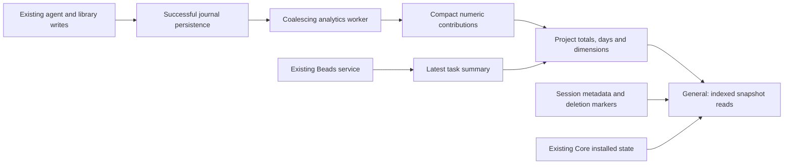

# Project dashboard analytics persistence

Status: proposed design; repository code has not been changed for this task.
Analysis date: 2026-10-12. Beads: `jarvis-y7xk`.

## Outcome and accepted product decisions

Keep a small, durable analytics ledger and already-computed project summaries in the existing SQLite database. Update them incrementally after successful journal persistence. The General tab reads these summaries; it does not open conversation journals. Deleting conversations keeps analytics but removes their actual history and associated files.

The user explicitly selected both of these rules:

- Deleted conversations remain in Recent sessions with their last title and activity date, an “Excluída” label, and no action to open them.
- Deleting an entire project deletes its analytics too. Conversation deletion and conversation cleanup preserve analytics. Workspace deletion also removes its projects and their analytics.

These decisions settle the retention and navigation questions needed by this design. Implementation is a separate step from this analysis.

## Confirmed current behavior

The following findings come from source inspection, not a runtime benchmark.

| Evidence | Current implementation | Consequence |
|---|---|---|
| E1 | [`library::dashboard::sources`](/Users/enesolucoes/Documents/Pessoal/jarvis/src-tauri/src/library/dashboard.rs:75) selects current rows from `conversations`, verifies each conversation/header, and resolves its journal. | Deleted conversation rows stop contributing, even if an old entry still exists in the memory cache. |
| E2 | [`get_project_metrics`](/Users/enesolucoes/Documents/Pessoal/jarvis/src-tauri/src/agent/dashboard.rs:229) iterates those sources, reads metrics, merges every session, and takes the first five as recent sessions. | Every request enumerates the project's remaining conversations and reconstructs project totals from their summaries. |
| E3 | [`DashboardState::read`](/Users/enesolucoes/Documents/Pessoal/jarvis/src-tauri/src/agent/dashboard.rs:157) caches by file path, modification time, and length. Cache misses call `journal::read_only` and `summarize`; the cache is cleared at 256 entries. | Unchanged files can avoid replay within one app process. Changed files are replayed, restart loses the cache, and this cache is not historical storage. Replay also occurs while holding the dashboard cache mutex. |
| E4 | [`useDashboardQuery`](/Users/enesolucoes/Documents/Pessoal/jarvis/src/hooks/use-dashboard-query.ts:7) refreshes on mounting, library/Beads events, window focus, and a 20-second visible-page timer. [`ProjectDashboard`](/Users/enesolucoes/Documents/Pessoal/jarvis/src/components/dashboard/ProjectDashboard.tsx:26) starts both metric and board queries at component level. | Refresh work is repeated and is not restricted to the General tab. Running on `spawn_blocking` protects the async executor, but does not remove disk/CPU work. |
| E5 | [`library::deletion::delete`](/Users/enesolucoes/Documents/Pessoal/jarvis/src-tauri/src/library/deletion.rs:326) stages files by renaming them, deletes SQL rows in a transaction, commits, and uses recovery/cleanup for staged files. | There is already a recoverable deletion protocol to extend. Analytics preservation must join its transaction, not run as a best-effort action after files disappear. |
| E6 | [`cleanup_confirmed`](/Users/enesolucoes/Documents/Pessoal/jarvis/src-tauri/src/agent/cleanup.rs:88) rechecks confirmed candidates, skips busy/queued sessions, and calls the same library deletion function. | Manual and bulk cleanup must share the preservation contract; existing selection, active-session, and last-conversation protections must remain. |
| E7 | [`SessionWriter`](/Users/enesolucoes/Documents/Pessoal/jarvis/src-tauri/src/agent/session_writer.rs:1) already serializes journal writes on a dedicated worker and supports flush barriers. [`drain_once_using`](/Users/enesolucoes/Documents/Pessoal/jarvis/src-tauri/src/agent/session_writer.rs:254) removes an operation only after its write succeeds. | Successful durable writes provide an integration point. Renderer streaming events are not a reliable accounting source. |
| E8 | [`initialize_database`](/Users/enesolucoes/Documents/Pessoal/jarvis/src-tauri/src/persistence.rs:334) deliberately uses a rollback journal with one mutex-serialized connection. [`AppState::with_connection`](/Users/enesolucoes/Documents/Pessoal/jarvis/src-tauri/src/persistence.rs:644) holds that connection's mutex for the operation. | Background replay or waiting for another worker inside this mutex would still block unrelated database users. Short transactions matter more than adding WAL to the current topology. |
| E9 | [`history.rs`](/Users/enesolucoes/Documents/Pessoal/jarvis/src-tauri/src/agent/history.rs:1) describes its index as disposable. Its persisted index includes excerpts, replay information, and a tail turn, and is a journal sidecar. | It is useful for replay/cursor concepts, but retaining it after chat deletion would retain chat content and would not provide independent durable analytics. |
| E10 | [`get_project_beads`](/Users/enesolucoes/Documents/Pessoal/jarvis/src-tauri/src/core/beads/dashboard.rs:191) loads the project's Beads store; `board` runs `bd list --status=all --limit=0`. | Task and workflow indicators have an independent source already. Their current state must not become a lifetime sum of status changes. |

No persistent project analytics projection is present in the inspected dashboard path. The existing tests cover read-only replay, repeated checkpoints, partial tails, auxiliary usage, and cache accounting; they do not establish preservation after conversation deletion.

## Coverage of every General section

The full section inventory comes from [`DashboardOverview`](/Users/enesolucoes/Documents/Pessoal/jarvis/src/components/dashboard/DashboardOverview.tsx:17), [`UsageEfficiency`](/Users/enesolucoes/Documents/Pessoal/jarvis/src/components/dashboard/UsageEfficiency.tsx:11), and the [`Metrics`/`Efficiency` contract](/Users/enesolucoes/Documents/Pessoal/jarvis/src-tauri/src/agent/dashboard.rs:10).

| Section | Durable data to use | Behavior after deleting a conversation |
|---|---|---|
| Sessions / interactions | Number of distinct registered analytical sessions; distinct turns. | Historical totals remain. Session count includes sessions that were later deleted, including empty sessions, matching today's registration-based counting rule. Make its historical meaning clear in the UI. |
| Tokens | Measured input and output token sums, including currently counted auxiliary requests. | Totals remain. Missing measurement stays distinguishable from a measured zero. |
| Tools / errors | Tool call counts and error counts from committed turn revisions. | Totals remain; pending-to-completed updates do not create another call. |
| Closed tasks / epics | Latest successfully read Beads status counts and epic count, with source timestamp. | Unaffected by chat deletion. Reopening a task updates the current count; it does not increment an irreversible completion total. |
| Project rhythm | Turn counts by UTC day, retaining all recorded days and querying the last 30 for the current chart. | Deletion does not remove points; old days naturally leave the displayed 30-day window. |
| Accumulated tokens | Input/output, measured steps, compactions, and corrected execution duration. | All accumulated values remain. |
| Intelligent context use | Every `Efficiency` counter: cache reads/writes, measured cache input and request counts, indexed output counts and original/retained bytes, read reuse counts and bytes. | Counts and correct weighted denominators remain. Percentages are calculated from saved sums, never by averaging per-chat percentages. |
| Detailed efficiency measurements | Context searches, loop steers, avoided calls, auxiliary calls/input/output, and the other existing cache/content counters. | All remain; detailed panels use the same durable facts as the headline panel. |
| Models used | Counts by existing account/model key. | Distribution remains even if the source chat or account is removed. Keep historical labels as data, without a foreign key to a removable provider account. |
| Workflow | Latest Beads counts by status and completion ratio. | Unaffected by chat deletion; continues to reflect the current board. Cached data is labeled when a refresh fails. |
| Jarvis Core | Historical tool-name counts for Context-mode/Graft/Beads; current installed state/version from the existing Core service. | Historical call counts remain. Installation/version indicators continue to describe the current installation; Ponytail currently has no call counter. |
| Recent sessions | Last title, creation/activity dates, turn count, and deletion marker. | Deleted rows remain readable as metadata, with “Excluída” and no clickable navigation. |

Persist the existing `changedFiles` counter too, although the current overview does not display it. Preserve current accounting semantics in the initial migration: measured usage only; allowed auxiliary tools only; current turn/model/day counting. Do not silently introduce new metrics or change parent/child session attribution.

## Proposed data model

Use the existing `jarvis.db`, existing Rust/rusqlite code, and the next normal Drizzle/Rust migration. No new dependency, server, inference request, or event broker is needed.

Five small logical tables are sufficient; their exact SQL column layout belongs to implementation:

1. `analytics_sessions`: project and conversation identity, last title/activity, deletion marker, replay cursor/fingerprint and projection version. Conversation identity is a plain identifier, **not a foreign key to `conversations`**. This keeps metadata alive after the conversation row disappears. Record registration/renaming/activity through the existing library operations.
2. `analytics_turns`: one compact numerical contribution per stable `(project_id, conversation_id, turn_id)`, with its last applied source revision, UTC day, model key, tool-count histogram, and existing metric counters. Store only the latest contribution, not every stream/checkpoint revision. Session-level extras such as compaction/file counts have their own compact contribution in the session record.
3. `project_analytics`: precomputed lifetime scalar totals, projection version/coverage, update time, and latest compact Beads status summary/source time.
4. `project_analytics_days`: materialized daily turn counts, indexed by project/day.
5. `project_analytics_dimensions`: materialized counts by project and model/tool key.

All analytical records belong to a project, with deletion cascading from `projects`, but never from a conversation or provider. Recent sessions have an index on project/activity; the normal overview reads five rows. Stable project IDs provide scope; canonical filesystem paths do not replace identity keys.

The compact contributions become durable analytical facts. They are not a disposable cache: once the corresponding chat is removed, they are the only remaining source for those counters. Materialized totals can be rebuilt from these numerical facts without any chat content. A future projection-version change must migrate old facts in place, not drop them and assume deleted journals can be replayed.

## Incremental update and query flow

The worker processes **committed** numerical changes, using already available turn state and the journal's replay machinery for recovery. Text-only streaming updates must not trigger repeated full-turn summarization or journal replay. Coalesce updates for a running turn, allow a short bounded freshness delay, and force final processing at completion/deletion barriers. A suggested live cadence is at most one snapshot per second, subject to measurement; it is not a claim about observed performance.

For each contribution, the same SQLite transaction reads the old numerical contribution, replaces it with the newer one, applies `new - old` to the relevant project totals/day/model/tool buckets, and advances the cursor. Repeated checkpoints and restart replay therefore do not add tokens or turns twice. Corrections can adjust totals; deleting chat content cannot subtract historical consumption. Stream timing, retries and imported/replayed data must use existing stable identities and actual stored usage, not guesses.

Use a bounded/coalescing dirty queue, not one retained job per token. A dropped notification must schedule reconciliation rather than silently lose accounting. Journal and SQLite writes are not one atomic transaction: if the app exits between them, a stored cursor plus background reconciliation recovers the committed tail. A cursor cannot be only a byte offset: compaction replaces journal files, so use validated source identity/fingerprint and stable turn IDs. Never replay provider calls or tools to repair analytics.

Keep decoding, replay, file reads, and waits outside `AppState::with_connection`. Only prepared numerical transactions use that shared connection. Reuse the current rollback-journal topology initially; adding WAL without independent readers does not remove its mutex. Use bounded batches and yield between them, prioritize new live data over backfill, and handle contention without holding the journal writer hostage. Exact batch sizes/time budgets must be measured during implementation.

`get_project_metrics` becomes an indexed snapshot query: project totals, displayed day range, model/tool counts, coverage, and recent metadata. It does not call `sources`, `read_conversation`, `journal::read_only`, or `summarize` for every chat. Basic formatting and percentages from saved counters remain cheap frontend calculations.

Publish a scoped analytics-updated event only after the database transaction commits. General retains the previous snapshot while refreshing and validates the returned project identity. Replace analytics' generic 20-second full projection polling with scoped/coalesced updates and a cheap recovery/focus fallback. Do not change the generic query hook indiscriminately for its other callers.

For Beads, keep the last successful compact status summary for instant General rendering and refresh it in the background through the existing Beads source/events, with a bounded fallback for external changes. Only loading Kanban requires the complete board. If Beads is unavailable, show the saved summary's time and error state; do not silently replace it with zero tasks. Core installed state continues using the existing Core service. Neither becomes a fake cumulative metric.

## Deletion and storage reclamation

Extend the existing protocol, including both the manual deletion coordinator and bulk cleanup:

1. Keep existing identity, confirmation and active/queued-session checks. Capture the selected source's final committed revision after the existing journal/session barriers.
2. Prepare any unapplied numerical facts **outside** the shared database mutex. Do not wait for an analytics worker while holding the connection that worker needs. Bulk cleanup must be adjusted to prepare outside its current long `with_connection` closure and still recheck selection/activity before deletion.
3. In the deletion transaction, apply prepared facts, retain title/activity, mark the analytics session deleted, and delete the actual conversation row. Protect this phase from late worker updates to a deleted session.
4. Commit and complete the existing staged-file cleanup/recovery. The dashboard continues reading analytics and cannot offer to open the removed chat.

Rollback must leave conversation metadata and analytics consistent. A crash after commit must retain the historical facts and finish file cleanup on recovery. If new analytics cannot be committed, do not destroy the only remaining source and claim preservation succeeded. A journal that was already missing/corrupt is different: retain any confirmed facts, report incomplete coverage, and do not fabricate missing values or make cleanup permanently impossible because of damage that already existed.

Journal compaction retains analytical facts and may invalidate only replay cursors, requiring reconciliation of that source. Any reset/import path that removes unprojected history must seal the contribution before replacement. Companion-only history clearing should keep its existing scope; do not add its private sessions to visible-project totals.

On project/workspace deletion, remove analytical facts/summaries with their owning projects; reject late queued writes so they cannot recreate orphaned analytics. Skip analytical backfill/preservation for this branch: replaying chats only to delete their analytics would waste work. Keep the existing session shutdown and filesystem recovery protocol. Removing a project is consequently different from cleaning its conversations, as explicitly chosen by the user.

Space is reclaimed because messages, prompts, outputs, provider wire data, screenshots, attachments, diff contents, and journal/index files continue to be removed through their existing cleanup paths. Analytics retains only identifiers/labels, dates, compact counters, and small histograms. There is no hidden transcript copy or permanent telemetry event log.

Analytical storage still grows with distinct turns, sessions and used dimensions; it is not zero or an arbitrary fixed size. Its size is independent of the length of responses, tool outputs or images, and repeated streaming revisions overwrite one contribution. Measure this footprint and actual bytes freed with representative histories; no storage ratio has been benchmarked in this analysis.

## Migration, recovery and limits

- Create the empty schema quickly; run the initial backfill once in a resumable background worker. Read current conversation metadata and replay available journals in bounded work units, without holding the shared SQLite mutex during parsing. Existing index/cursor concepts may be reused without persisting their excerpts/tail text in analytics.
- Mark initialization/projection coverage explicitly. While backfill runs, display saved data with “Preparando histórico”/partial coverage, not an apparently complete zero dashboard. Opening General must not synchronously finish migration.
- Coordinate backfill with live writers using source revisions/stable IDs. A later backfill result cannot overwrite a newer committed contribution. Resume only pending/changed sources on restart.
- Before deleting a not-yet-backfilled chat, prepare and persist its remaining facts using the same deletion barrier. This prevents the migration/cleanup race from losing history.
- A missing source keeps already saved facts and a coverage warning. Complete data must not turn into zero just because a journal temporarily cannot be read.
- Previously deleted chats without an independent copy cannot be reconstructed. The current code's cache is volatile and is not an archival source. No invented totals or claims of complete historical recovery.
- SQLite failure or a damaged analytical database must be reported distinctly from “no usage.” Retained numerical facts allow rebuilding rollups, but losing both the database and already deleted chats is unrecoverable without an external backup.
- The current [`backup.rs`](/Users/enesolucoes/Documents/Pessoal/jarvis/src-tauri/src/backup.rs:1) exports **settings**, not complete project/chat data. Do not claim the new analytics is protected by that feature or silently expand the settings backup. A broader data backup/export is outside this task.
- Preserve unknown-vs-zero usage flags, cache numerators/denominators, millisecond durations and UTC day boundaries. There is no new retention-time setting, chart range selector, estimation mechanism or provider request in this first design.

## Reference comparison and decisions

### ADR 1 — Durable projection in the existing database

Proposed. Codex [`apply_rollout_item`](/Users/enesolucoes/Documents/Pessoal/jarvis/docs/codex/codex-rs/state/src/extract.rs:28) extracts metadata from rollout items; [`apply_rollout_items`](/Users/enesolucoes/Documents/Pessoal/jarvis/docs/codex/codex-rs/state/src/runtime/threads.rs:1059) upserts that metadata. Its token handler assigns cumulative usage instead of adding the same total repeatedly. Adopt event-derived, idempotent projection; do not claim this proves retention after deletion.

OpenCode's [`SessionTable`](/Users/enesolucoes/Documents/Pessoal/jarvis/docs/opencode/packages/core/src/session/sql.ts:22) keeps numerical token/cost fields separately from message bodies. Messages reference sessions with deletion cascade. Adopt compact stored facts, but make Jarvis analytical sessions independent of removable conversation rows, as the user requires.

Alternative: one JSON file per chat would still be coupled to per-chat deletion and would require project-wide merging. A project JSON snapshot avoids that coupling but would require a new atomic replacement/recovery protocol and increasingly large whole-file rewrites. The existing SQLite transaction/migration/deletion infrastructure is a smaller complete fit.

### ADR 2 — Materialized project summaries with small contribution receipts

Proposed. OMP's [`rollup.ts`](/Users/enesolucoes/Documents/Pessoal/jarvis/docs/omp/packages/stats/src/rollup.ts:1) describes precomputed dimensions, dirty buckets, short refresh transactions and explicit backlog/staleness. Adopt precomputation and bounded background work; Jarvis currently needs daily rhythm and lifetime totals, not OMP's whole hourly/range-query engine. OMP rollups also depend on their raw sources, so that architecture alone does not establish the requested deletion independence.

Keeping only a single project total is insufficient: repeated revisions, corrections and recovery would have no receipt identifying already counted contributions. Replaying all chats on every change would preserve correctness only while files exist and recreate the performance problem. Compact per-turn/latest-session receipts plus transactionally updated totals solve both.

### ADR 3 — Separate historical usage from current state

User retention decisions accepted; detailed implementation proposed. Conversation-derived use is historical, so deletion never subtracts it. Beads task states and Core installation remain current, using saved summaries where appropriate and explicit refresh timestamps. Deleted recent entries retain title/date without navigation. Project deletion cascades analytical data. No raw conversation content is retained to achieve this.

## Implementation reach and meaningful acceptance checks

Implementation must reach these existing contracts, not only the rhythm chart:

- Drizzle schema/migration and Rust persistence registration; numerical types/version migration and constraints.
- Rust dashboard accounting/projection and its colocated tests; preserve all current `Metrics`/`Efficiency` semantics.
- Journal writer integration, flush/finalization, recovery and compaction handling; extraction and replay remain backend work.
- Library creation/title/activity and manual deletion coordinator; bulk cleanup and existing deletion recovery tests.
- Beads dashboard summary refresh and source timestamps; current Core state stays in its existing service.
- Frontend dashboard schema/query, General rendering, Recent sessions deletion state, efficiency panels, existing fixtures/tests and app command/state wiring. Do not break Kanban or other generic query callers.

Checks for the later implementation:

1. Populate every metric and all dimensions; delete one chat manually and another through cleanup; restart. All historical fields and graphs remain equal, while deleted metadata has no open action and files are actually removed.
2. Process the same turn/checkpoint repeatedly, update usage/tool status, crash between journal and SQLite persistence, then recover. Each numerical contribution is counted once and corrections remain accurate.
3. Delete during backfill; simulate deletion rollback/committed-but-unfinished file cleanup, a missing source and SQLite contention. Coverage is explicit and confirmed data is not silently lost.
4. Compact/rewrite journals and change titles; verify cursor recovery and stable history. Remove provider/plugin configuration without erasing historical model/tool labels.
5. Exclude queued/busy sessions using existing cleanup semantics; verify project/workspace deletion removes analytics and queued worker jobs cannot resurrect it.
6. Query General after deleting source journals: assert the read path uses stored facts and performs **zero journal reads**. With large fixtures, measure opening latency, worker batch/lock time, renderer responsiveness and database size. Performance targets remain unverified until these measurements exist.
7. Change Beads task status and simulate an unavailable store; General updates current counts or shows the last valid summary with freshness/error information. Deleted recent rows do not invoke session selection.

Run required repository quality gates when implementation occurs. This task is a source analysis and design: no code, build, benchmark, native UI/UAT, or test execution is claimed.
